<!--
IMAGE MAPPING (check before submitting):
This report assumes the screenshots in image/ were taken in runbook order:
image/1.png = S00, image/2.png = S01, ... image/29.png = S28.
S29 (helm package) and S30 (git commit) are shown as terminal output instead.
If any image is in a different position, just change its number below.
-->

# DSO202 Assignment 3: Packaging the Task Tracker with Kustomize and Helm

**Module:** DSO202, Unit III (Configuration and Package Management)
**Student:** Namgyel Huk
**Repository:** https://github.com/NamgyelHuk708/SS26_DSO202 (`assignment/assignment-3`)

---

## 1. Introduction

In Assignment 1, I deployed the three-tier Task Tracker (nginx frontend, Node.js backend, PostgreSQL database) with plain Kubernetes manifests. In Assignment 2, I improved it by moving the database to a StatefulSet and putting an NGINX Ingress in front of the app.

The aim of Assignment 3 is to take that Assignment 2 setup and manage it with the two tools from Unit III:

- **Kustomize**, to keep one shared *base* and describe only the differences for each environment in *overlays*.
- **Helm**, to package the same application as a versioned *chart* and manage each installation as a *release* with a history.

I deployed both a **dev** and a **prod** environment with each tool, tested the app through the Ingress, and also broke things on purpose to see which check catches which mistake.

---

## 2. Starting point and what changed from Assignment 2

I did not edit my Assignment 1 or 2 files. Assignment 3 is a separate, self-contained folder. The A2 manifests were copied once into the Kustomize base, and the Helm templates were written from that base.

| A2 file | Kustomize (A3) | Helm (A3) |
|---|---|---|
| `database/statefulset.yaml` | `base/db-statefulset.yaml` + prod JSON 6902 patch (2Gi) | `templates/db-statefulset.yaml` |
| `configmap.yaml` | `configMapGenerator` from `base/config.env` | `templates/configmap.yaml` |
| `secret.yaml` (password committed in plain text) | `secretGenerator` from a gitignored `db-secret.env` per overlay | `templates/secret.yaml` + gitignored `secrets-<env>.yaml` |
| `frontend/nginx-proxy-configmap.yaml` | removed (not needed any more) | removed |
| `ingress.yaml` (no host) | base + one host per overlay (JSON 6902 patch) | `templates/ingress.yaml`, host from values |

I also made these deliberate changes while moving to A3:

1. **Fixed the A2 label bug.** In A2, the StatefulSet Pod only had `tier: database`, so `db-svc` (which selects on `app` and `tier`) had no endpoints. The A3 base adds `app: database`.
2. **The frontend image now runs unmodified.** In A1/A2, I mounted a custom `nginx.conf` and entrypoint because `BACKEND_URL=""` was replaced by the image with `http://localhost:8080`. Now `BACKEND_URL=.`, so the browser calls `./api/tasks`, which becomes `/api/tasks`, and the Ingress routes that to the backend. This answers the open question in my A2 reflection.
3. **Secrets are out of Git.** Only `.example` files are committed.
4. **Database probes added.** `pg_isready` readiness and liveness probes, with slow timings because Postgres runs under arm64 emulation.
5. **RBAC updated.** The read-only role from A1 Task 8 can now also read StatefulSets and Ingresses.
6. **One Ingress host per environment** (`kust-dev`, `kust-prod`, `helm-dev`, `helm-prod` `.tasks.local`), because all four environments share one NGINX controller.

---

## 3. Environment setup

### 3.1 Cluster

My A1/A2 cluster no longer existed, so I created a new kind cluster just for this assignment (`cluster/kind-cluster.yaml`). It has one control-plane and two workers on Kubernetes v1.36.1. Compared to my Practical 1 config, I changed three things:

- the control-plane gets the label `ingress-ready=true`;
- host port **30080** is mapped to port **80** on the control-plane, where the NGINX controller listens (port 80 on my laptop is already used by Apache);
- the cluster is named `dso202-a3`.

Tools used: kind v0.32.0, kubectl v1.37.1 (with Kustomize v5.8.1 built in) and Helm v4.3.0, running on Pop!_OS with Docker Desktop.

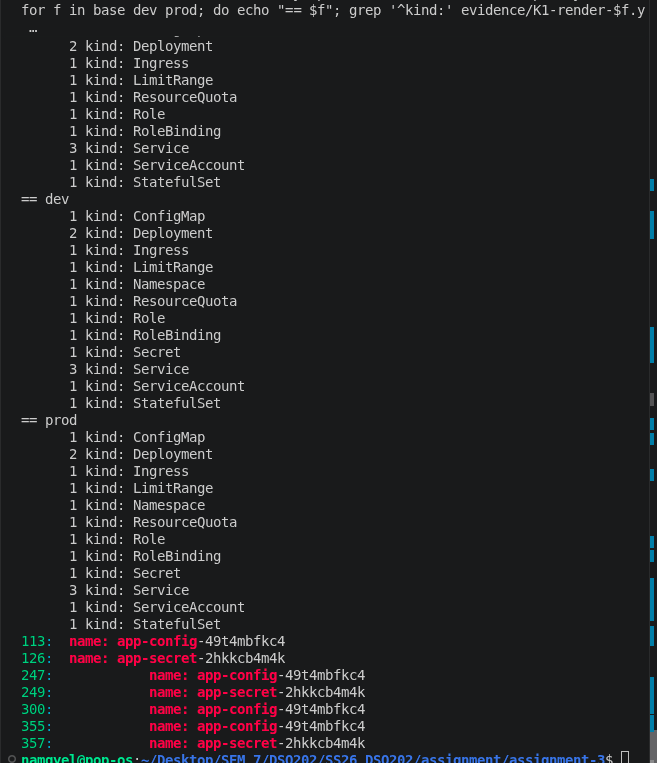
*S00: All three nodes Ready, the ingress controller running on the control-plane, and the `404 Not Found` from NGINX, which means `localhost:30080` reaches the controller (it just has no routes yet).*

### 3.2 Problems I had during setup

**Problem 1: The arm64 images.** The provided images (`sarojsanyasi/dso202-*:1.0`) are arm64 only, and my laptop is amd64. Same as in A1, I needed QEMU emulation. Before deploying anything, I ran a test Pod that printed `uname -m` from the database image inside kind. It printed `aarch64`, so emulation worked. The images are loaded with `kind load docker-image`, and every manifest uses `imagePullPolicy: Never`.

**Problem 2: The ingress controller images would not download inside kind.** `crictl pull` inside the node ran for the full 15-minute timeout and downloaded nothing. It was the same stalled pull I had in A2. This time, I pulled the two images on my host with `docker pull` (which worked) and loaded them into kind. The official manifest pins each image by **digest** (`tag@sha256:…`), so before loading, I checked that the digest I pulled matched the digest in the manifest. Both matched. I then made a local copy of the manifest without the digests (`cluster/ingress-nginx-kind-local.yaml`), because kind stores loaded images by tag only.

**Problem 3: The controller started on the wrong node.** It was scheduled on `worker-node-1`, so `curl localhost:30080` got no answer. When I checked the Deployment, its nodeSelector only had `kubernetes.io/os: linux`, without `ingress-ready`. I fixed it with a small patch (`cluster/ingress-controller-patch.yaml`) that adds the `ingress-ready: "true"` selector and a control-plane toleration. After that, the controller moved to the control-plane and the 404 came back.

**Note:** The Kubernetes project announced in late 2025 that ingress-nginx is being retired, and Gateway API is the recommended way forward. I kept ingress-nginx to stay consistent with Assignment 2.

---

## 4. Folder structure

```
assignment-3/
├── cluster/                  # kind config, ingress manifests, controller patch
├── kustomize/
│   ├── base/                 # shared manifests + config.env + kustomization.yaml
│   └── overlays/
│       ├── dev/              # namespace, secret, host patch
│       └── prod/             # + replicas, resources, quota, storage patches
├── helm/
│   ├── task-tracker/         # the chart
│   └── environments/         # dev.yaml, prod.yaml, secrets-*.yaml (gitignored)
├── evidence/                 # rendered YAML files
├── image/                    # screenshots
├── RUNBOOK.md                # the exact commands I followed
└── README.md
```

---

## 5. Part A: Kustomize

### 5.1 Base and overlay design

The base holds everything that is the same in every environment. The overlays only hold the differences. I followed the idea from the lecture: *"base stores what is shared, overlay stores what is different."*

| What differs | dev | prod | Kustomize mechanism |
|---|---|---|---|
| Namespace | `dso202-a3-kust-dev` | `dso202-a3-kust-prod` | `namespace:` |
| Environment label | dev | prod | `labels:` with `includeSelectors: false` |
| Backend / frontend replicas | 1 / 1 | 2 / 2 | `replicas:` transformer |
| Backend resources | base | bigger | strategic merge patch |
| ResourceQuota | base | raised | strategic merge patch |
| DB volume size | 1Gi | 2Gi | JSON 6902 patch |
| Ingress host | `kust-dev.tasks.local` | `kust-prod.tasks.local` | JSON 6902 patch |
| `CORS_ORIGIN` | `*` | prod host | `configMapGenerator` with `behavior: merge` |
| DB credentials | own file | own file | `secretGenerator` |

I used **strategic merge** when the change looks like a normal Kubernetes fragment (resources, quota), and **JSON 6902** when I needed an exact path, such as the first item of `volumeClaimTemplates` or the first Ingress rule's host.

I did **not** use `namePrefix`. Kustomize does not rewrite `DB_HOST=db-svc` inside ConfigMap values, so a prefix would have broken the database connection. Separate namespaces already keep the environments apart.

### 5.2 Rendering before applying

Before touching the cluster, I rendered the base and both overlays. As the lecture says, *"rendered YAML is the truth."*

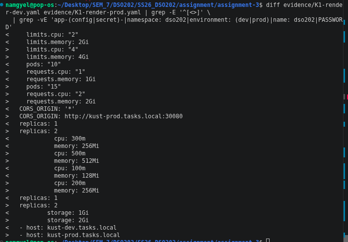
*S01: The base renders 13 objects; dev and prod render 15 each (the overlays add a Namespace and a Secret). The ConfigMap and Secret have a hash suffix (`app-config-49t4mbfkc4`, `app-secret-2hkkcb4m4k`), and Kustomize updated every reference to them.*

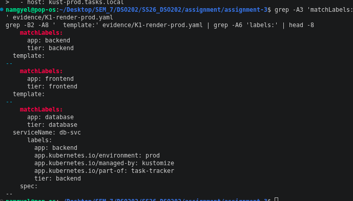
*S02: The diff between the dev and prod renders, showing only the intended differences: quota, CORS, replicas, backend resources, `storage: 2Gi` and the host.*

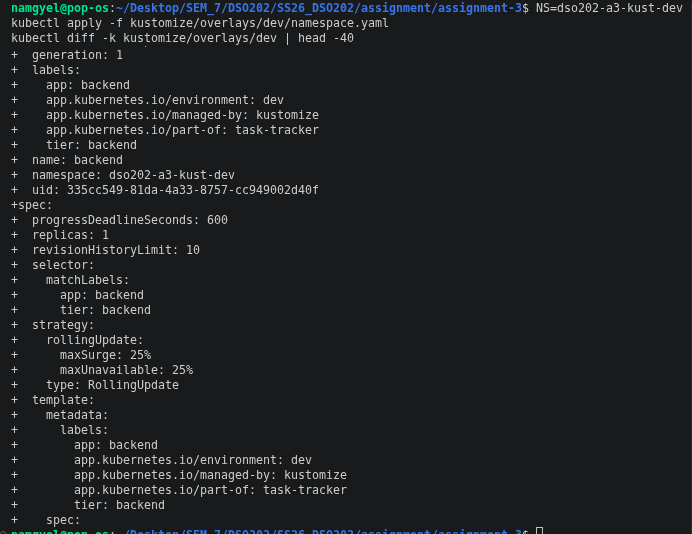
*S03: The selectors only contain `app` and `tier`, while the Pod labels also have `environment`, `part-of` and `managed-by`. I used `includeSelectors: false` because selectors are immutable. I hit the "field is immutable" error in A2, so I did not want to repeat it.*

### 5.3 Deploying dev

I applied the namespace first, because `kubectl diff` does a server-side dry run, and that fails for objects in a namespace that does not exist yet.

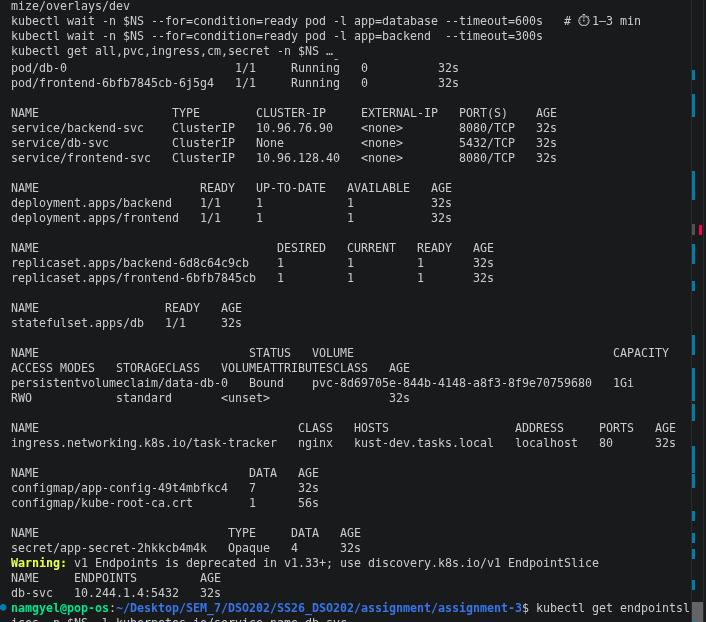
*S04: `kubectl diff -k` showing what would be created before applying anything.*

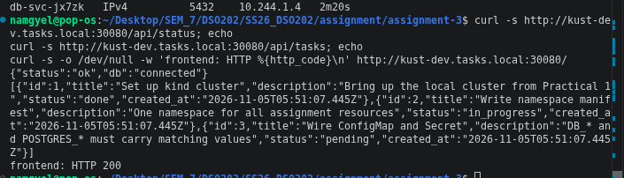
*S05: The dev environment running: all Pods 1/1, PVC `data-db-0` Bound, Ingress host `kust-dev.tasks.local`, and most importantly, **`db-svc` has an endpoint** (`10.244.1.4:5432`). This proves the A2 label bug is fixed.*

kubectl also warned that `v1 Endpoints` is deprecated from Kubernetes 1.33 onward; `EndpointSlice` is the replacement.

### 5.4 Testing through the Ingress

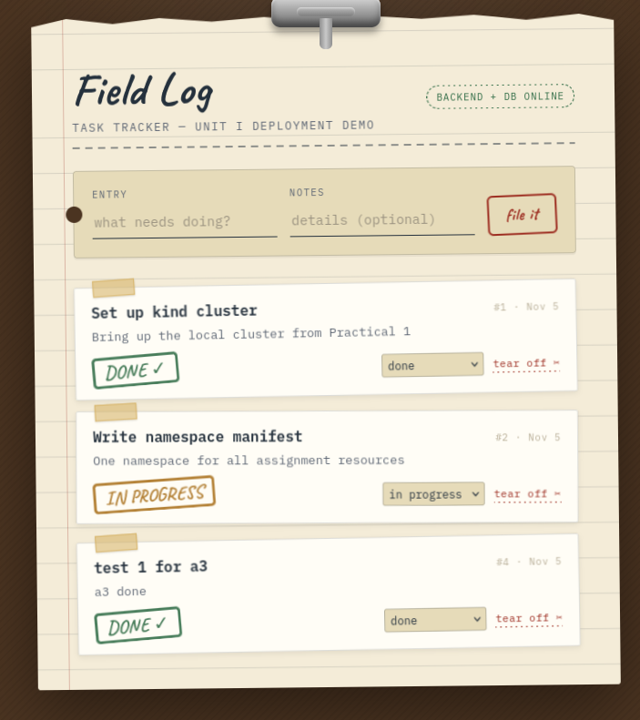
*S06: `/api/status` returns `{"status":"ok","db":"connected"}`, `/api/tasks` returns the seed tasks, and the frontend returns HTTP 200, all through `kust-dev.tasks.local:30080`.*

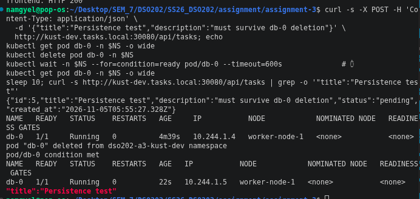
*S07: The app in the browser. I added a task, changed a status and deleted a task. The frontend talks to the backend only through the Ingress.*

### 5.5 StatefulSet persistence

First, I created a task called "Persistence test" (id 5), then deleted the `db-0` Pod.

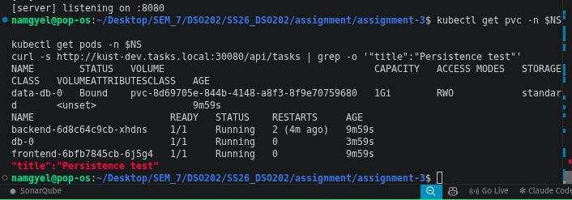
*S08: `db-0` came back with the **same name** on the same node, with a new IP (`10.244.1.4` → `10.244.1.5`). The task was still there.*

Then I deleted the **whole StatefulSet**, not just the Pod.

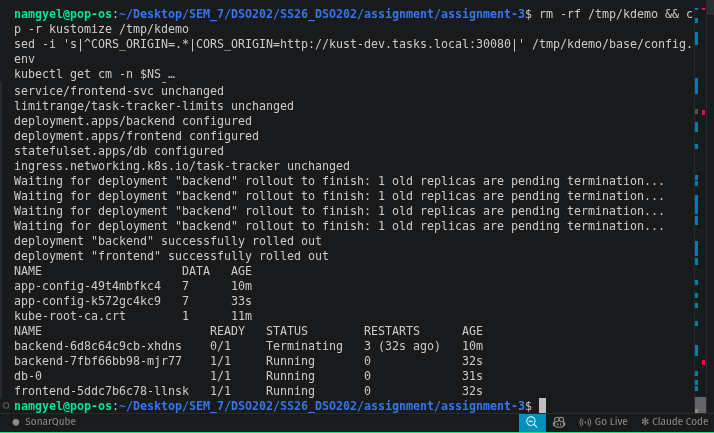
*S09: The PVC stayed Bound to the same volume (`pvc-8d69705e…`) because of `persistentVolumeClaimRetentionPolicy: Retain`. `kubectl apply -k` recreated only the StatefulSet (everything else was `unchanged`), the new `db-0` re-attached the old volume, and the task was still there.*

**Something I noticed:** right after the StatefulSet came back, my first `curl` returned nothing. The backend Pod showed `RESTARTS 2`: the backend process crashed when the database disappeared, and Kubernetes restarted it automatically. On startup, the backend code waits for the database, so it recovered by itself. The readiness probe on `/api/status` (which runs `SELECT 1`) keeps traffic away from the backend until the database is reachable again.

### 5.6 Config change → new hash → rolling update

To test this without changing my repository, I copied the kustomize folder to `/tmp`, changed `CORS_ORIGIN` in the copy, and applied it.

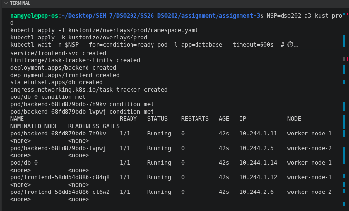
*S10: A new ConfigMap `app-config-k572gc4kc9` appeared next to the old one. The diff shows the reference swapped in **three** places (backend, frontend, db). All three workloads were `configured`, and new Pods started.*

This shows the chain from the lecture: **content changes → hash changes → reference changes → Pod template changes → rollout**. Without the hash, changing a ConfigMap would not restart the Pods at all.

Two observations:
- Kustomize **did not delete the old ConfigMap** (`app-config-49t4mbfkc4`). It is harmless, but old ConfigMaps build up over time.
- The old backend Pod crashed once more (`RESTARTS 3`) because `db-0` restarted at the same time, the same behaviour as in 5.5.

To go back, I just re-applied the real overlay. The original hash already existed, so the Pods switched back to it.

### 5.7 Deploying prod

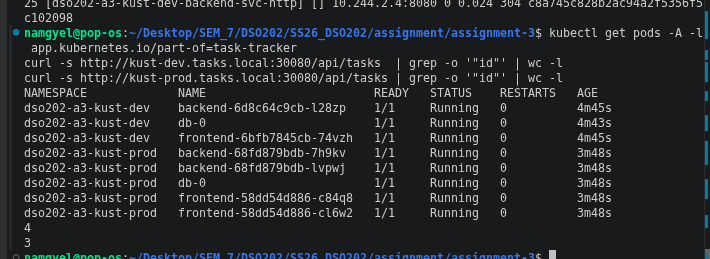
*S11: Prod running with 2 backend and 2 frontend Pods spread across `worker-node-1` and `worker-node-2`, a **2Gi** PVC, and the prod Ingress host.*

The ResourceQuota `Used` column matched what I calculated in `patch-quota.yaml` exactly: requests 600m CPU / 768Mi memory, and limits 1900m CPU / 1792Mi memory. So the quota was sized by calculation, not by guessing.

My first `curl` to prod returned **503** from NGINX, because the Pods had only just become ready and the controller had not picked up the endpoints yet. A few seconds later, the same request returned `{"status":"ok","db":"connected"}`.

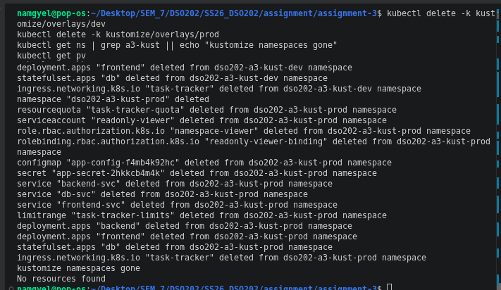
*S12: Both environments running at the same time from the same base. Dev has my extra tasks while prod only has the 3 seed tasks, so the data is separate.*

One thing I noticed: my dev and prod Secrets got the **same hash** (`app-secret-2hkkcb4m4k`), because I used the same password in both files. The setup supports different passwords per environment, but to really show that, I should have used different ones.

### 5.8 Deleting with Kustomize

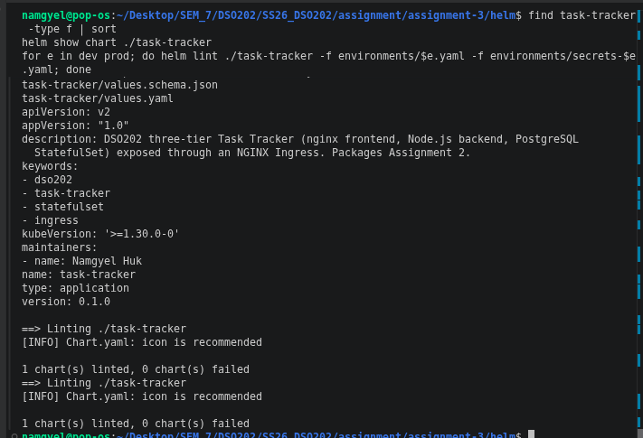
*S13: `kubectl delete -k` removed both environments, including their PVCs.*

**Important finding:** `delete -k` also deletes the **Namespace**, because the namespace is a resource in the overlay. Deleting a namespace deletes all the PVCs inside it, no matter what the StatefulSet's `Retain` policy says. So `Retain` only protects the PVC when the StatefulSet is deleted or scaled down (as in 5.5), not when the whole namespace goes.

---

## 6. Part B: Helm

### 6.1 Chart structure

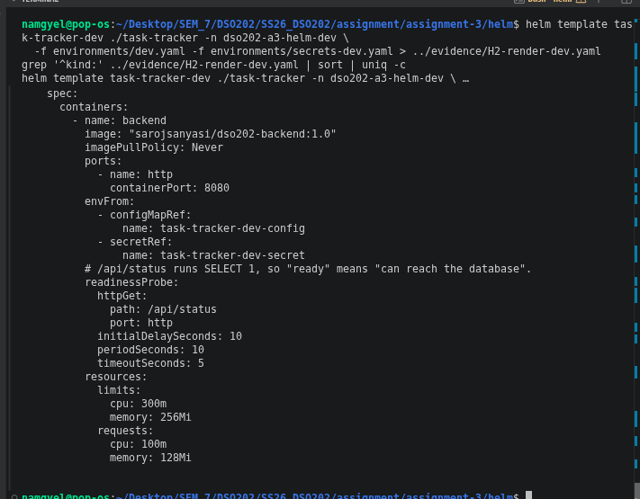
*S14: The chart files, `Chart.yaml`, and `helm lint` passing for both environments. The `[INFO] icon is recommended` line is only a suggestion.*

`Chart.yaml` has two different versions: `version: 0.1.0` is the version of the **chart** (the package), and `appVersion: "1.0"` is the version of the **application images**. If I only change a template, I bump `version`. If I use new images, I change `appVersion` and also bump `version`, because a file in the chart changed.

Environment values live **outside** the chart in `helm/environments/`, because they belong to the deployment, not to the chart:

- `dev.yaml` sets only the environment name and host. Everything else comes from the chart defaults.
- `prod.yaml` sets 2 replicas, bigger backend resources, 2Gi storage and a bigger quota.
- `secrets-dev.yaml` and `secrets-prod.yaml` hold the database user and password, and are gitignored.

### 6.2 Templates and helpers

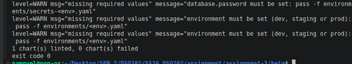
*S15: The rendered backend Deployment.*

The things I want to point out in this render:

- **Names come from the release:** `task-tracker-dev-backend`, `task-tracker-dev-config`, and so on. All the names are built in `_helpers.tpl`, so `DB_HOST` is created by the same helper that names the database Service and can never be wrong.
- **Two label sets:** `selectorLabels` only has `name`, `instance` and `component`, which never change. The full label set adds `helm.sh/chart` and `app.kubernetes.io/version`, which **do** change between versions. If those were in the selector, every upgrade would fail, because selectors are immutable.
- **Checksum annotations:** `checksum/config` and `checksum/secret` are hashes of the rendered ConfigMap and Secret. If the config changes, the hash changes and the Pods roll. This is Helm's version of Kustomize's hash suffix.
- **Image tag from appVersion:** `image.tag` is empty, so it falls back to `appVersion` and becomes `sarojsanyasi/dso202-backend:1.0`.

### 6.3 Validation: breaking things on purpose

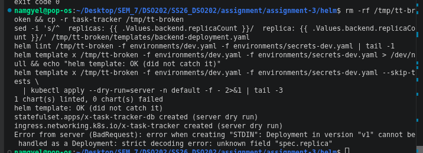
*S16: The four failures and `helm lint` on its own.*

- **F1 and F2:** my `required` checks stop the render with a clear message when the environment or the credentials are missing.
- **F3:** `tag: 1.0` without quotes is read by YAML as the **number** 1.0, and `values.schema.json` caught it (`got number, want string`). Without the schema, this would quietly become a bad image tag.
- **F4:** four wrong values were all reported **at once**.
- **F5:** `helm lint` **knows** the required values are missing, but it only prints warnings and still exits with code 0.

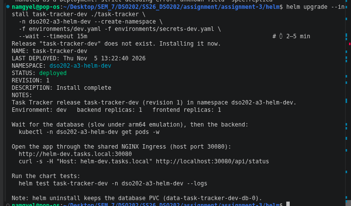
*S17: I misspelled `replicas:` as `replica:` in a copy of the chart. `helm lint` passed, `helm template` passed, and only `kubectl apply --dry-run=server` rejected it with `unknown field "spec.replica"`. The StatefulSet and Ingress were accepted before the error, which shows how a real install can fail halfway.*

So no single check is enough:

| Check | Missing required value | Wrong value type | Misspelled Kubernetes field | Needs a cluster |
|---|---|---|---|---|
| `helm lint` | warning only (exit 0) | yes (schema) | no | no |
| `helm template` | yes | yes (schema) | no | no |
| `helm template \| kubectl apply --dry-run=server` | yes | yes | **yes** | yes |

### 6.4 Install, test and inspect the release

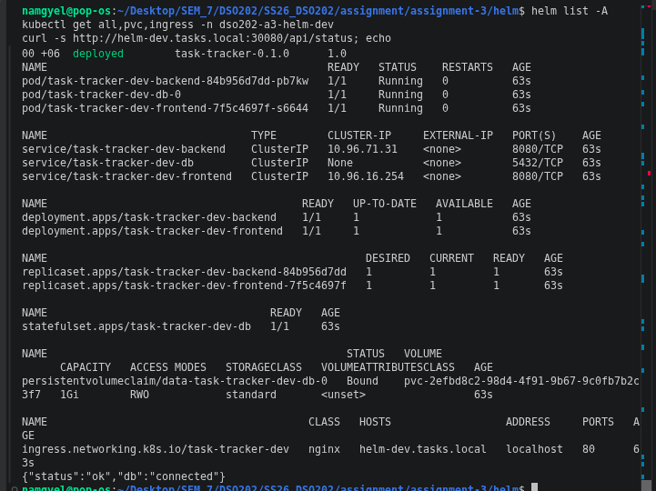
*S18: `helm upgrade --install` for dev: `STATUS: deployed`, `REVISION: 1`, and my NOTES.txt telling the user how to reach the app and run the tests.*

I used `helm upgrade --install` instead of `helm install` because it works whether or not the release exists yet, which is the normal choice for scripts and CI.

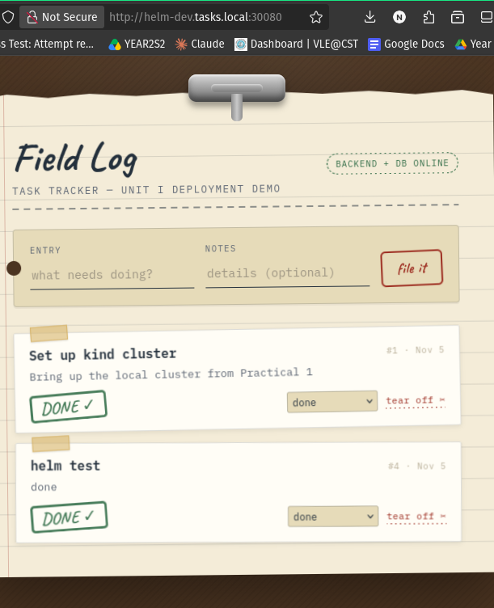
*S19: The dev release: every object named `task-tracker-dev-*`, PVC Bound, and the API answering through `helm-dev.tasks.local`.*

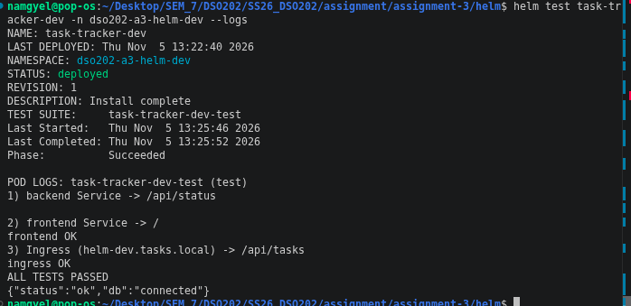
*S20: The Helm dev environment working in the browser.*

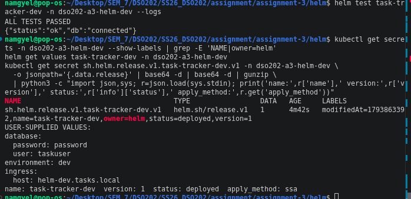
*S21: `helm test` passed. My test Pod checks three paths: the backend Service (`/api/status` must say `"db":"connected"`), the frontend Service, and the **full Ingress path**, using the release's Host header.*

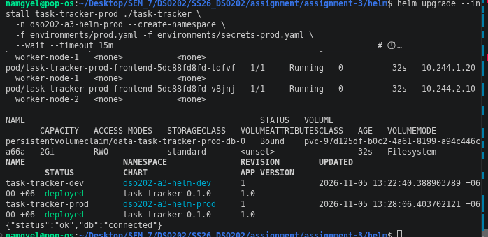
*S22: The release record.*

- Helm stores each revision as a Secret called `sh.helm.release.v1.task-tracker-dev.v1`, labelled `owner=helm`.
- `helm get values` shows the database **password in plain text**.
- The record shows `apply_method: ssa`, meaning Helm 4 used server-side apply.

This is a real weakness: anyone who can read Secrets in that namespace can get the password back from Helm. In a real company, I would use something like External Secrets or Sealed Secrets instead of passing the password as a value.

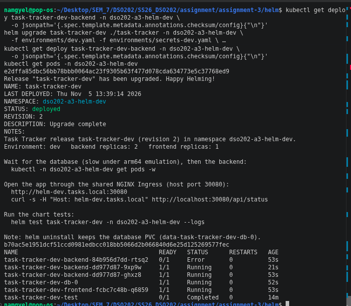
*S23: The prod release: 2 backend and 2 frontend Pods, a 2Gi PVC, and both releases listed by `helm list -A`.*

### 6.5 Upgrade, history and rollback

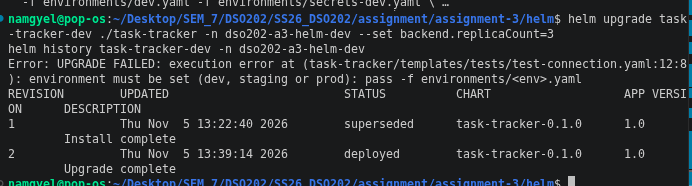
*S24: Upgrading dev to revision 2, changing the backend replicas to 2 and the CORS origin.*

The `checksum/config` value changed from `e2dffa85…` to `b70ac5e1…`, and all three tiers rolled out with new Pods. What I found interesting is that `e2dffa85…` was **exactly** the checksum I saw in 6.2 with `helm template`, before anything was installed. The checksum is deterministic: the same values always give the same hash.

During this upgrade, an old-ReplicaSet backend Pod ended up in `Error`, because the replica change and the database restart happened at the same time. It was removed by the rollout. In practice, it would be better to change replicas and config in separate upgrades.

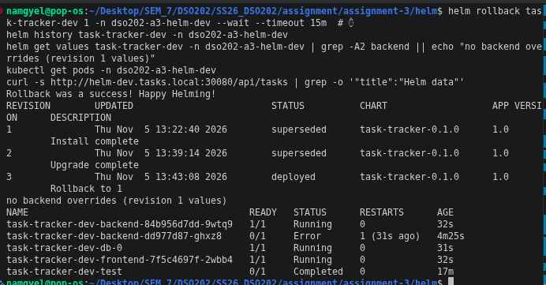
*S25: The `--set` pitfall. Running `helm upgrade` with only `--set backend.replicaCount=3` was **refused** with `environment must be set`, and `helm history` shows that **no revision 3 was recorded**.*

When you give `helm upgrade` any value flag, it starts again from the chart defaults and **drops** the values used before. In the lecture's podinfo demo, this silently halved the replicas. In my chart, the `required` checks turn that silent mistake into an error. The real fix is to always pass every values file (`-f`) on every upgrade.

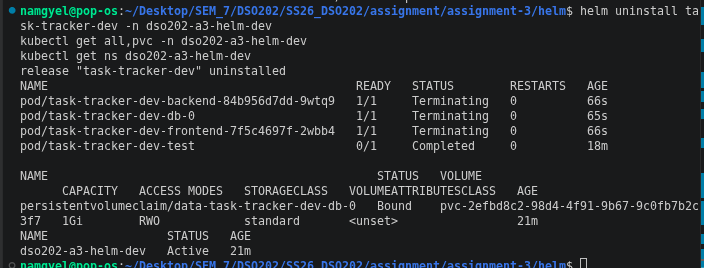
*S26: `helm rollback task-tracker-dev 1`. History now shows 1 superseded, 2 superseded and **3 "Rollback to 1"**. The values are back to revision 1 (no backend overrides), and there is one backend Pod again.*

A rollback does not go back to revision 1; it creates a **new** revision (3) that copies revision 1. A rollback also only re-applies the manifests: it does not restore or remove any data in the database, because the data lives in the PVC.

### 6.6 Uninstall and reinstall

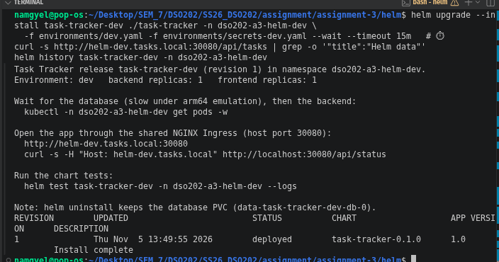
*S27: After `helm uninstall`, the Pods were terminating, but the PVC `data-task-tracker-dev-db-0` was still **Bound**, and the namespace was still Active.*

This happens because the PVC is created by the StatefulSet controller from `volumeClaimTemplates`, not by Helm, so Helm does not delete it. The namespace stays because `--create-namespace` does not make the namespace part of the release.

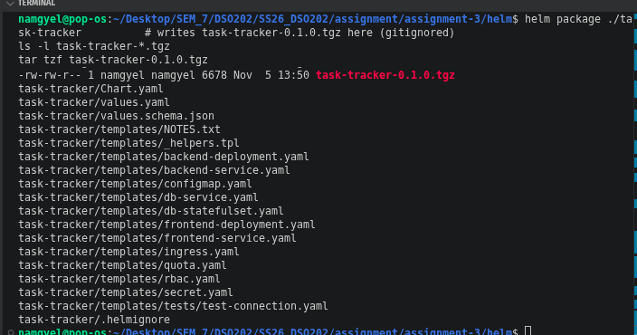
*S28: Reinstalling the release. The history started again at revision 1, and the same PVC name was re-attached.*

**Honest note:** my `grep` check for a task called "Helm data" after the rollback and after the reinstall printed nothing, so these screenshots do not prove the data itself survived on the Helm side. Data persistence was proven in the Kustomize part (section 5.5), where a task survived both Pod deletion and StatefulSet deletion. What the Helm run does prove is that the PVC is kept across `helm uninstall` and re-attached on reinstall.

**A trap I learned about:** Postgres only reads `POSTGRES_PASSWORD` when its volume is empty. If I reinstalled with a different password, the old volume would keep the old one and the backend would fail to log in. For a really clean start, the PVC has to be deleted by hand.

### 6.7 Packaging

```
$ helm package ./task-tracker
Successfully packaged chart and saved it to: .../assignment-3/helm/task-tracker-0.1.0.tgz
-rw-rw-r-- 1 namgyel namgyel 6678 Nov  5 13:50 task-tracker-0.1.0.tgz
```

The package is 6.7 KB, contains the chart files only, and has **no secrets**, because the environment files are outside the chart. The `.tgz` is gitignored.

### 6.8 Committing safely

Before committing, I checked that no secret file or package was staged:

```
$ git diff --cached --name-only | grep -E 'db-secret\.env$|secrets-(dev|prod)\.yaml$|\.tgz$' \
    && echo "!! STOP: secret or package staged" || echo "safe to commit"
safe to commit
[main 365bbcb] a3: kustomize base/overlays, helm chart, evidence
 78 files changed, 3498 insertions(+)
```

Only the `.example` files were committed. This fixes the A1/A2 problem, where my password was committed in `secret.yaml`.

---

## 7. Kustomize vs Helm

| | Kustomize | Helm |
|---|---|---|
| How it works | Patches plain YAML (base + overlays) | Renders templates with values |
| Input files | Normal, valid Kubernetes YAML | Templates (not valid YAML until rendered) |
| Built into kubectl | Yes (`kubectl apply -k`) | No, a separate tool |
| Config change → restart | Hash suffix on generated ConfigMaps | `checksum/*` annotations (written by me) |
| Input validation | None of its own | `required` + `values.schema.json` |
| Remembers what was installed | No | Yes, a release record per revision |
| Rollback | Re-apply older files (Git) | `helm rollback <release> <revision>` |
| Removal | `delete -k` (also deleted my namespace and PVCs) | `helm uninstall` (kept the PVC and namespace) |
| Sharing with others | A Git folder | A versioned `.tgz` chart |
| What I found easier | Small environment differences, easy to read | Reusable package with checks and history |

**My opinion:** Kustomize was easier to understand at first, because everything is still normal YAML, and the rendered diff made it very clear what changes between dev and prod. Helm took more work (helpers, indentation, the schema), but it gave me things Kustomize cannot do: input validation, release history, rollback by revision number, tests, and a package I could give to someone else. For my own app with a few environments, I would choose Kustomize. For an app that other people install, I would choose Helm.

---

## 8. Challenges

1. **Disk and memory.** My disk was 95% full. I removed my old LocalStack setup and the empty Practical 5 cluster, and pruned about 12 GB of Docker build cache, before creating the A3 cluster.
2. **arm64 images.** QEMU emulation was gone after a reboot. I checked it with a `uname -m` test Pod. Postgres under emulation starts slowly, so my probes use long delays.
3. **Ingress images stuck downloading inside kind.** Solved by pulling on the host, checking the digests, and loading them with `kind load` (section 3.2).
4. **Controller on the wrong node.** The manifest had no `ingress-ready` selector; solved with a patch file.
5. **The backend crashes when the database restarts.** I saw this in K6, K7 and the Helm upgrade. Kubernetes restarts it automatically, but it means a short outage after every database restart.
6. **Timing.** A few checks failed only because they ran a few seconds too early (the prod 503, the first `curl` after the StatefulSet came back). Waiting with `kubectl wait` before testing fixed them.
7. **`delete -k` removes the namespace.** I first planned to show the PVC surviving `delete -k`, but the namespace deletion removes it. I changed the test to delete only the StatefulSet.

---

## 9. Reflection

The biggest thing I learned is that **these tools only produce YAML**: Kubernetes itself never sees `kustomization.yaml` or a Helm template. Looking at the rendered output before applying (`kubectl kustomize`, `helm template`) helped me catch problems early, and comparing the dev and prod renders showed exactly what each environment changes.

The validation demo surprised me. I expected `helm lint` to catch a misspelled field like `replica:`, but neither `lint` nor `template` did; only the API server did. Even for missing values, `helm lint` only warns and still returns success. So a CI pipeline should render every environment and run a server-side dry run, not just lint.

I also understand storage better now. In A2, I only saw that a PVC survives a Pod deletion. In A3, I found three different cases: the PVC survives a StatefulSet deletion (`Retain`), it survives `helm uninstall` (Helm does not own it), but it does **not** survive the namespace being deleted (`delete -k`).

Finally, this assignment fixed several things from A1/A2: the missing `app: database` label, the custom frontend config (replaced by `BACKEND_URL=.`), and the password committed to Git.

If I did it again, I would:
- use different passwords for dev and prod;
- add a task before every data-persistence check and wait for the backend to be ready;
- change replicas and config in separate upgrades;
- look at Gateway API instead of ingress-nginx, since ingress-nginx is being retired.

---

## 10. Conclusion

I packaged my Assignment 2 Task Tracker (StatefulSet database plus NGINX Ingress) with both Kustomize and Helm, and ran a dev and a prod environment with each tool on one kind cluster.

With **Kustomize**, one base and two overlays describe the environments. Generators with hash suffixes made config changes roll out automatically, and the StatefulSet kept its data through Pod and StatefulSet deletion.

With **Helm**, one chart with a schema, required values, checksums and a test covered the full release lifecycle: install, test, upgrade, a refused bad upgrade, rollback, uninstall with the PVC kept, reinstall, and packaging.

Both tools solved the copy-paste problem from A1/A2. Helm added safety checks and history, while Kustomize stayed simpler and closer to plain Kubernetes YAML.

---

## 11. References

Helm Authors. (2026). *Helm documentation* (v4). https://helm.sh/docs/

Helm Authors. (2026). *Chart template guide*. https://helm.sh/docs/chart_template_guide/

Helm Authors. (2026). *Chart development tips and tricks: Automatically roll deployments*. https://helm.sh/docs/howto/charts_tips_and_tricks/

Kubernetes Authors. (2026). *Declarative management of Kubernetes objects using Kustomize*. https://kubernetes.io/docs/tasks/manage-kubernetes-objects/kustomization/

Kubernetes Authors. (2026). *StatefulSets: PersistentVolumeClaim retention*. https://kubernetes.io/docs/concepts/workloads/controllers/statefulset/

Kubernetes Authors. (2026). *Recommended labels*. https://kubernetes.io/docs/concepts/overview/working-with-objects/common-labels/

Kubernetes SIGs. (2026). *kind: Ingress*. https://kind.sigs.k8s.io/docs/user/ingress/

Bryan, P., & Nottingham, M. (2013). *JavaScript Object Notation (JSON) Patch* (RFC 6902). IETF. https://www.rfc-editor.org/rfc/rfc6902

DSO202 Module Team. (2026). *Unit III 3.1 Kustomize* and *Unit III 3.2 Helm* [Lecture notes]. College of Science and Technology.