# DSO202 Practical 6: Packaging and Deploying an Application with Helm on Kind

---

## 1. Objective

In Practical 5 I used Kustomize to deploy the same NGINX page to several environments by patching plain YAML. In this practical I did the same kind of job with Helm. Helm works differently: it fills in templates with values, and it keeps a record of every install, upgrade and rollback in the cluster.

The practical had two parts. First I used a chart written by someone else (podinfo) to learn how releases work. Then I wrote my own chart, called `webapp`, from an empty folder and deployed it to a dev and a prod environment.

By the end of the practical I was able to:

- install, inspect, upgrade, roll back and uninstall a Helm release;
- explain the difference between a chart version and an application version;
- write templates using values, built-in objects, named templates, `if`, `with` and `range`;
- predict how values from `values.yaml`, `-f` files and `--set` flags are merged;
- stop bad values early using `required` and a `values.schema.json`;
- explain which mistakes each check (`helm lint`, `helm template`, dry runs) can and cannot find;
- recover from a failed upgrade automatically with `--rollback-on-failure`;
- see how Helm 4's server-side apply reacts when someone changes an object with `kubectl`.

Several steps were done on purpose to fail. For each one I recorded the error, the cause and the fix.

---

## 2. Environment

| Item | Value |
|---|---|
| Host operating system | Pop!_OS (Linux) |
| Docker | *[output of `docker info --format '{{.ServerVersion}}'`]* |
| kind | *[output of `kind version`]* |
| kubectl (client) | *[output of `kubectl version --client`]* |
| Helm | *[version from screenshot 2]* |
| Kubernetes (cluster) | v1.36.x |
| Cluster name and context | `dso202-p6`, `kind-dso202-p6` |
| Published chart used | podinfo 6.15.0 |
| Application image of my chart | `nginx:1.30-alpine` |
| Test image | `busybox:1.37` |

I created a new cluster for this practical instead of reusing the Practical 5 one. The P5 cluster does not publish port 30080 to the host, and the dev release of my chart needs that port. The new cluster has one control-plane node and two workers with the same node names as before (`control-plane`, `worker-node-1`, `worker-node-2`).

---

## 3. Repository layout

```
dso202-practical-06/
├── README.md
├── cluster/
│   └── kind-cluster.yaml         three nodes, host port 30080 published
├── environments/
│   ├── dev.yaml                  NodePort 30080, 1 replica
│   └── prod.yaml                 3 replicas, bigger CPU and memory
├── webapp/                       the chart I wrote
│   ├── .helmignore
│   ├── Chart.yaml
│   ├── values.yaml
│   ├── values.schema.json
│   ├── charts/
│   └── templates/
│       ├── _helpers.tpl
│       ├── configmap.yaml
│       ├── deployment.yaml
│       ├── service.yaml
│       ├── NOTES.txt
│       └── tests/
│           └── test-connection.yaml
├── evidence/                     saved text output
└── images/                       screenshots
```

The environment files are kept outside the chart folder on purpose. The chart is the package, and it should be the same for every environment. The environment files only describe how one particular install should be configured.

---

## 4. Procedure and Observations

### 4.1 Stage 0: Preparing the cluster and installing Helm

I created the cluster from `cluster/kind-cluster.yaml` and checked that I was using the right context.

```bash
kind create cluster --config cluster/kind-cluster.yaml
kubectl config current-context
kubectl get nodes
```

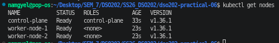

The context is `kind-dso202-p6` and all three nodes are `Ready`.

Next I installed Helm 4 with the official `get-helm-4` script and checked that no APT source points to `baltocdn.com`. The Helm maintainers warned that this old mirror domain changed owner and may serve harmful packages.

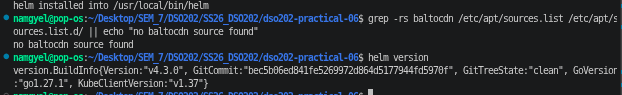

`helm version` shows a 4.x release, and the grep printed `no baltocdn source found`. The `KubeClientVersion` field in the output is the Kubernetes library Helm was built with. It is not the version of my cluster.

Then I looked at where Helm keeps its local files and confirmed it can talk to the cluster.

```bash
helm env | grep -E 'HELM_(NAMESPACE|MAX_HISTORY|REPOSITORY_CONFIG|REPOSITORY_CACHE|REGISTRY_CONFIG)'
helm list -A
```

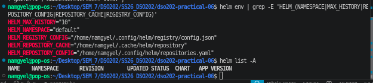

`HELM_MAX_HISTORY="10"` means Helm keeps only the last ten revisions of each release. `helm list -A` printed only the column names because there were no releases yet. Since it ran without an error, Helm could reach the API server.

### 4.2 Stage 1: Using a published chart (podinfo)

#### Adding and searching the repository

```bash
helm repo add podinfo https://stefanprodan.github.io/podinfo
helm repo update
helm search repo podinfo
helm search repo podinfo --versions | head -4
```

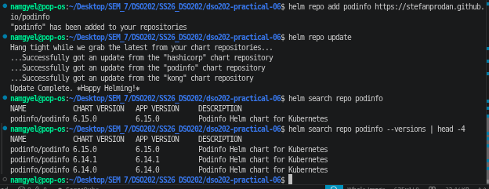

`helm repo add` only saves the URL. `helm repo update` downloads the repository's `index.yaml` so that searches have something to read. The search shows two version columns. `CHART VERSION` is the version of the package, and `APP VERSION` is the version of the software inside it. For podinfo both are 6.15.0, but they do not have to match.

#### Reading the chart before installing

```bash
helm show chart podinfo/podinfo --version 6.15.0
helm show values podinfo/podinfo --version 6.15.0 | head -20
```

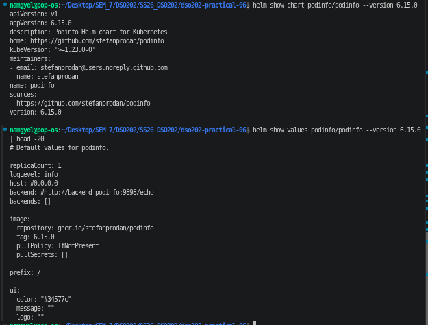

Installing a chart runs someone else's templates with my own cluster permissions, so I read it first. The `values.yaml` is the chart's settings menu. I could see `replicaCount: 1` and a `ui:` block with `message` and `color`, which are the settings I changed later. I also noticed `apiVersion: v1` in `Chart.yaml`. That is the old Helm 2 chart format. Helm 4 still installs it, but new charts should use `v2`.

#### Installing the release

```bash
helm install my-podinfo podinfo/podinfo \
  --version 6.15.0 \
  --namespace dso202-helm --create-namespace \
  --set replicaCount=2 \
  --set ui.message="Hello from DSO202" \
  --wait --timeout 5m
```

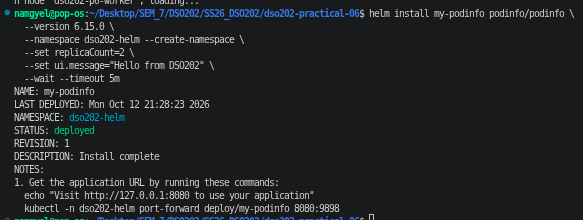

The release is `deployed` at `REVISION: 1`. My first try at this command failed with a timeout. The reason is explained in Section 7. `--version` pins the chart version so that the same command always installs the same thing, and `--wait` makes Helm wait until the Pods are ready before reporting success.

#### Listing releases

```bash
helm list -n dso202-helm
helm list
```

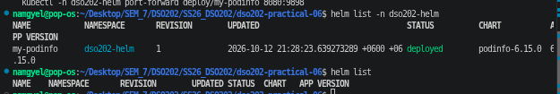

The first command shows `my-podinfo`. The second shows nothing because my current namespace is `default` and releases belong to a namespace. This is an easy mistake to make, so I now always pass `-n` or use `-A`.

#### Checking the objects and the app

```bash
kubectl get deploy,svc,pods -n dso202-helm
kubectl -n dso202-helm port-forward deploy/my-podinfo 8081:9898    # second terminal
curl -s http://localhost:8081 | grep -E '"(version|message)"'
```

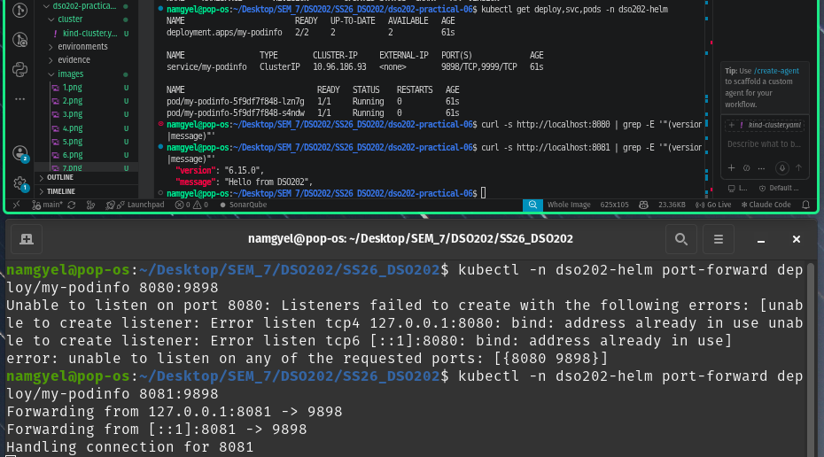

The Deployment shows `2/2` and both Pods are `Running`, so `replicaCount=2` worked. The curl response contains `"message": "Hello from DSO202"`, so my `--set` value reached the running app. I used local port 8081 instead of 8080 because 8080 was already taken on my laptop.

#### Inspecting the release record

```bash
helm status my-podinfo -n dso202-helm
helm get values my-podinfo -n dso202-helm
helm get values my-podinfo -n dso202-helm --all | head -5
helm get manifest my-podinfo -n dso202-helm | grep -E '^(# Source|kind:)'
```

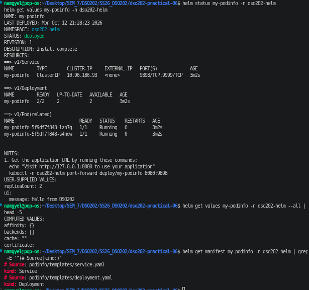

`helm get values` shows only the two values I typed. With `--all` it shows the full merged set, which is the chart defaults plus my values. `helm get manifest` shows the exact YAML Helm sent to the cluster, and the `# Source:` comments tell me which template made each object. All `helm get` commands read the stored release record, not the live objects.

#### Decoding the release Secret

```bash
kubectl get secrets -n dso202-helm --show-labels
kubectl get secret sh.helm.release.v1.my-podinfo.v1 -n dso202-helm \
  -o jsonpath='{.data.release}' | base64 -d | base64 -d | gunzip \
  | jq '{name, namespace, version, status: .info.status, apply_method, values: .config}'
```

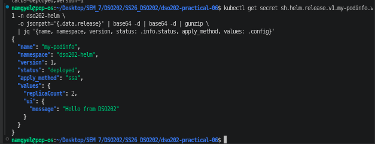

Helm stores each revision in a Secret named `sh.helm.release.v1.<release>.v<revision>`. The data is gzip-compressed JSON, base64-encoded twice. After decoding I could read my values in plain text. This means that if someone passes a password as a value, anyone who can read Secrets in that namespace can get it back. The field `apply_method: "ssa"` shows Helm 4 used server-side apply for this release.

#### Failure: an upgrade that silently loses values

I upgraded with only the new colour.

```bash
helm upgrade my-podinfo podinfo/podinfo --version 6.15.0 -n dso202-helm \
  --set ui.color="#2e7d32"
helm get values my-podinfo -n dso202-helm
kubectl get deploy my-podinfo -n dso202-helm -o jsonpath='{.spec.replicas}{"\n"}'
```

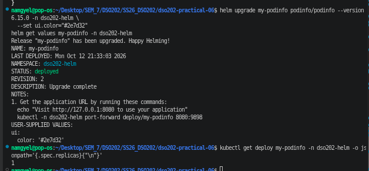

The upgrade reported success, but the user values now contain only `ui.color`, and the replica count dropped to `1`. My message was also gone. When `helm upgrade` is given any value flag, it starts again from the chart defaults and applies only the values in that command. The values from the install were thrown away without any warning. In a real company this could quietly scale production down.

#### Fix: `--reuse-values`

```bash
helm upgrade my-podinfo podinfo/podinfo --version 6.15.0 -n dso202-helm \
  --reuse-values --set replicaCount=2 --set ui.message="Hello from DSO202"
helm get values my-podinfo -n dso202-helm
```

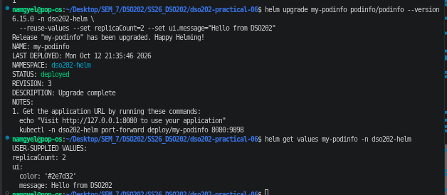

Now the values contain the colour, the message and `replicaCount: 2`. Helm has three modes for this:

| Flag | What it does |
|---|---|
| `--reset-values` | Chart defaults plus only this command's values |
| `--reuse-values` | Previous values plus this command's values. New defaults from a newer chart version are ignored |
| `--reset-then-reuse-values` | New chart defaults, then previous values, then this command's values. Safest when moving to a new chart version |

The better habit is to keep all values in files under Git and pass every file with `-f` on every upgrade. I did this for my own chart.

#### History and rollback

```bash
helm rollback my-podinfo 1 -n dso202-helm
helm history my-podinfo -n dso202-helm
helm get values my-podinfo -n dso202-helm
```

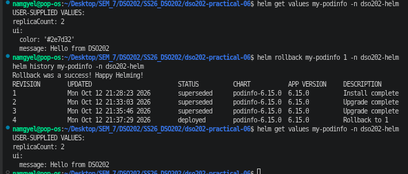

The rollback did not delete revisions 2 and 3. It created revision 4 with the description `Rollback to 1`, which is a copy of revision 1's chart and values. The history therefore shows everything that happened, in order. The values went back to `replicaCount: 2` and the message, without the colour.

#### Uninstalling

```bash
helm uninstall my-podinfo -n dso202-helm
kubectl get all,secrets -n dso202-helm
kubectl get namespace dso202-helm
```

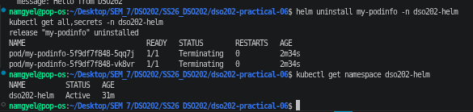

All objects and all release Secrets were removed. The namespace stayed `Active`, because `--create-namespace` creates the namespace but does not make it part of the release.

#### Installing from an OCI registry

```bash
helm show values oci://ghcr.io/stefanprodan/charts/podinfo --version 6.15.0 | head -3
helm install my-podinfo oci://ghcr.io/stefanprodan/charts/podinfo --version 6.15.0 \
  -n dso202-helm --set replicaCount=2
helm uninstall my-podinfo -n dso202-helm
```

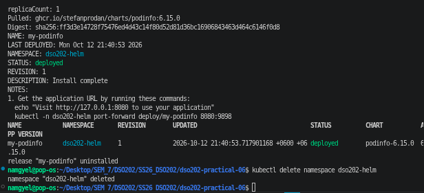

The same chart installed straight from `ghcr.io` with no `helm repo add` or `helm repo update`. Helm printed the digest of the chart it pulled. A digest is a SHA-256 hash, so it always points to exactly the same content, unlike a tag that can be moved. Companies like OCI registries because they already run one for container images.

### 4.3 Stage 2: The chart skeleton

Before writing my own chart, I generated the official scaffold to see the standard layout.

```bash
helm create scaffold
find scaffold -type f | sort
```

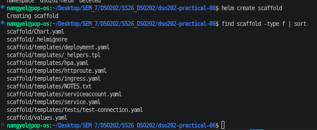

The Helm 4 scaffold includes `httproute.yaml` for the Gateway API as well as `ingress.yaml`. Its templates use many features at once, so I deleted it and built a smaller chart by hand.

I created `webapp/Chart.yaml`, `webapp/values.yaml`, `webapp/.helmignore` and the empty `templates/tests/` and `charts/` folders.

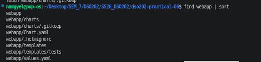

The important fields in `Chart.yaml` are:

- `apiVersion: v2`, the chart format for Helm 3 and Helm 4.
- `version: 0.1.0`, the version of the chart. It must go up whenever any file in the chart changes.
- `appVersion: "1.30-alpine"`, the version of NGINX. It is quoted because without quotes YAML would read `1.30` as the number `1.3`.
- `kubeVersion: ">=1.30.0-0"`, so Helm refuses to install on an older cluster. The `-0` lets pre-release Kubernetes builds pass the check too.

In `values.yaml`, `page.environment` is empty on purpose. The chart refuses to render until an environment is chosen.

### 4.4 Stage 3: Writing the templates

I wrote six template files: `_helpers.tpl`, `configmap.yaml`, `deployment.yaml`, `service.yaml`, `NOTES.txt` and `tests/test-connection.yaml`. I also wrote `environments/dev.yaml` and `environments/prod.yaml`.

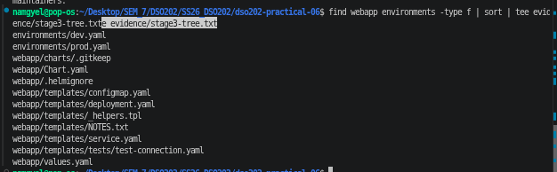

Some decisions in the templates:

- **Two label sets.** `webapp.selectorLabels` has only the name and instance. These are used in selectors and must never change, because a Deployment's selector cannot be edited after it is created. `webapp.labels` adds labels that do change, such as the chart version.
- **Checksum annotation.** The Deployment's Pod template has `checksum/config`, which is a SHA-256 hash of the rendered ConfigMap. A Deployment only rolls out new Pods when its Pod template changes. A ConfigMap change alone would not restart the Pods, but because the hash changes, it does.
- **Default image tag.** `image.tag` is empty, so the template falls back to `.Chart.AppVersion`.
- **`required`.** The `webapp.environment` helper stops rendering with my own error message if no environment is set.

I rendered the chart without touching the cluster and saved the output.

```bash
helm template webapp-dev ./webapp -f environments/dev.yaml --namespace dso202-dev \
  | tee evidence/stage3-dev-render.yaml
grep -E '^# Source|^kind:' evidence/stage3-dev-render.yaml
grep -E 'image:|checksum/config|limits:|requests:' evidence/stage3-dev-render.yaml
```

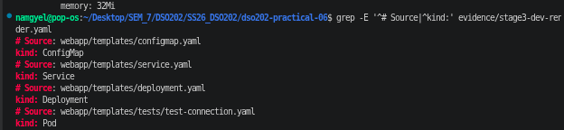

I noticed four things:

1. The objects came out as ConfigMap, Service, Deployment, then the test Pod. Helm sorts objects by kind, not by file name, so the ConfigMap exists before the Deployment that mounts it.
2. The image is `nginx:1.30-alpine`, taken from `appVersion`.
3. In the NGINX container `limits:` is printed before `requests:`, even though `values.yaml` lists them the other way round. This is because `toYaml` sorts keys. In the test Pod, `requests:` comes first because those lines are written directly in the template.
4. My checksum is `ba6522a4...`, not the `534e2ce7...` in the lesson notes. The hash covers the whole rendered ConfigMap, so even one different character gives a new hash. When I rendered again I got the same value, which is what matters.

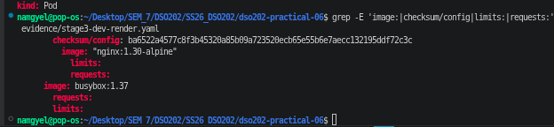

The Service is `type: NodePort` with `nodePort: 30080`, and its selector uses only the two stable labels. The object name is just `webapp-dev`, not `webapp-dev-webapp`, because the release name already contains the chart name and my `webapp.fullname` helper checks for that.

I also rendered a single file with `-s`.

```bash
helm template webapp-dev ./webapp -f environments/dev.yaml -n dso202-dev -s templates/configmap.yaml
```

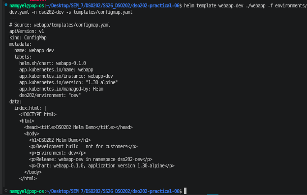

The HTML in the ConfigMap shows `Environment: dev`, the release name and namespace, and the chart version. All of it came from values and built-in objects.

### 4.5 Stage 4: How values are merged

Helm merges values in this order, lowest to highest: the chart's `values.yaml`, then `-f` files from left to right, then `--set` flags.

#### `--set` beats `-f`

```bash
helm template webapp-dev ./webapp -f environments/dev.yaml --set replicaCount=2 \
  -s templates/deployment.yaml | grep 'replicas:'
```

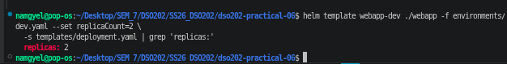

`dev.yaml` sets 1 replica, but the output is `replicas: 2` because `--set` has higher priority.

#### Layering environment files

```bash
helm template webapp-dev ./webapp -f environments/dev.yaml -f environments/prod.yaml \
  -s templates/service.yaml | grep -E 'type:|nodePort'
helm template webapp-dev ./webapp -f environments/dev.yaml -f environments/prod.yaml \
  -s templates/deployment.yaml | grep -E 'replicas:|environment'
helm template webapp-dev ./webapp -f environments/prod.yaml -f environments/dev.yaml \
  -s templates/deployment.yaml | grep -E 'replicas:|environment|cpu'
```

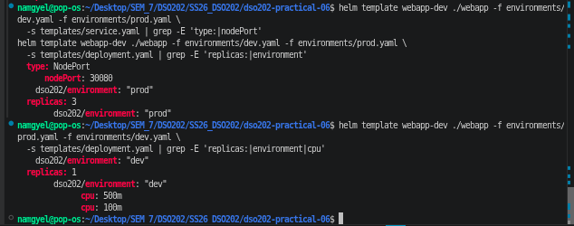

This surprised me. With `dev.yaml` then `prod.yaml`, the result says `prod` and has 3 replicas, but it still has `type: NodePort` and `nodePort: 30080`, because `prod.yaml` never mentions `service`. With the files the other way round, the result says `dev` but keeps prod's CPU values, because `dev.yaml` never mentions `resources`. Maps are merged key by key, so stacking files does not "switch" environment. Each environment file should be used alone on top of the chart defaults.

#### `--set` versus `--set-string`

```bash
helm template webapp-dev ./webapp -f environments/dev.yaml -s templates/deployment.yaml \
  --set 'podAnnotations.prometheus\.io/scrape=true' | grep scrape
helm template webapp-dev ./webapp -f environments/dev.yaml -s templates/deployment.yaml \
  --set-string 'podAnnotations.prometheus\.io/scrape=true' | grep scrape
```

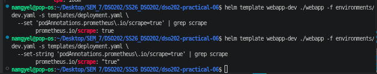

`--set` turned `true` into a boolean, so the output has no quotes. `--set-string` kept it as the string `"true"`. Both rendered without complaint, so I tried to install the first one.

```bash
helm install webapp-dev ./webapp -f environments/dev.yaml -n dso202-dev --create-namespace \
  --set 'podAnnotations.prometheus\.io/scrape=true'
```

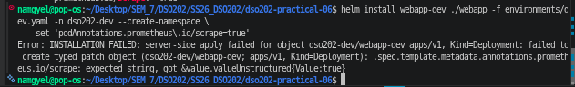

The API server rejected the Deployment because annotation values must be strings (`expected string, got ... true`). The template rendered fine, but the cluster did not accept it. I removed the failed release with `helm uninstall webapp-dev -n dso202-dev` before going on.

#### Deleting a default with `null`

```bash
helm template webapp-dev ./webapp -f environments/dev.yaml -s templates/deployment.yaml \
  --set resources.limits=null | sed -n '/resources:/,/volumeMounts/p'
```

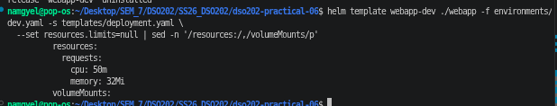

Setting a key to `null` removes it completely, even though the default comes from the chart. Only `requests` is left.

### 4.6 Stage 5: Checking the chart before installing

In this stage I broke the chart in four different ways to see which tool catches which mistake. Before each one I backed up `deployment.yaml` to `/tmp` so I could restore it with one `cp` command.

#### Failure 1: missing required value

```bash
helm template webapp-dev ./webapp
```

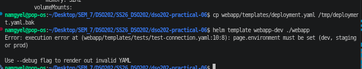

Without an environment file, rendering stopped with my own message: `page.environment must be set (dev, staging or prod)`. The error points to a template that uses the helper, not to `_helpers.tpl` itself, so the message text is what tells you the cause.

```bash
helm lint ./webapp; echo "exit code: $?"
helm lint --strict ./webapp; echo "exit code: $?"
```

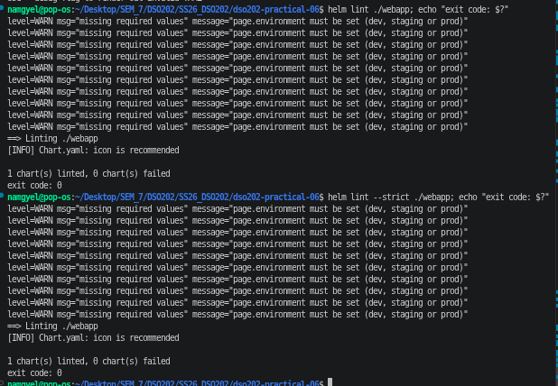

`helm lint` only printed a warning and exited with code 0, even with `--strict`. A CI pipeline that only runs `helm lint` would let this chart through. So CI should also run `helm template` for every environment's values file.

#### Failure 2: wrong indentation

I removed `nindent` from the resources line in `deployment.yaml`, so it became `{{ toYaml .Values.resources }}`.

```bash
helm template webapp-dev ./webapp -f environments/dev.yaml
```

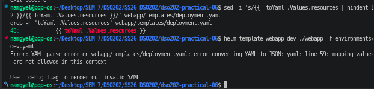

Rendering failed with `mapping values are not allowed in this context`. The message does not say what is wrong, so I used `--debug` to see the broken output.

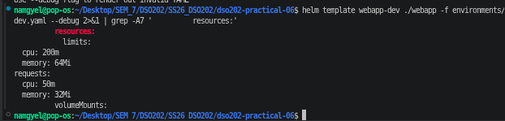

Only the first line of the `toYaml` output got the correct indentation. The rest started near the left edge, so the YAML structure fell apart. Templates only produce text and do not understand YAML, which is why `nindent` is always needed after `toYaml`. I restored the file.

#### Failure 3: a number instead of a string

```bash
printf 'image:\n  tag: 1.30\n' > /tmp/tag-float.yaml
helm template webapp-dev ./webapp -f environments/dev.yaml -f /tmp/tag-float.yaml \
  -s templates/deployment.yaml | grep 'image:'
```

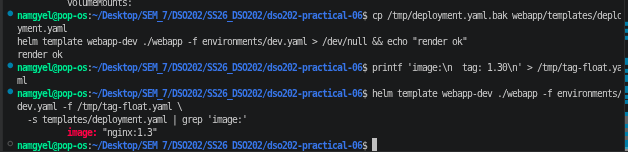

There was no error at all, but the image became `nginx:1.3`. YAML read `1.30` as a decimal number and dropped the zero. In the cluster this would end in `ImagePullBackOff`, or worse, run a very old image if that tag existed. This is the most dangerous of the four because nothing warns you.

#### Fix: a values schema

I added `webapp/values.schema.json`. Helm checks the merged values against it on every install, upgrade, lint and template, before rendering anything. I then tried three bad inputs.

```bash
helm template webapp-dev ./webapp -f environments/dev.yaml -f /tmp/tag-float.yaml
helm template webapp-dev ./webapp -f environments/dev.yaml --set replicaCount=three
helm template webapp-dev ./webapp -f environments/dev.yaml \
  --set replicaCount=0 --set service.type=LoadBalancer --set page.environment=test
```

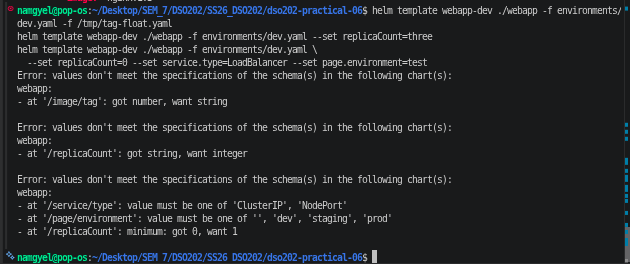

All three were stopped with clear messages:

- `/image/tag`: got number, want string
- `/replicaCount`: got string, want integer
- the last command listed three problems at once: an unknown environment, `replicaCount` below the minimum of 1, and a service type that is not allowed

The schema allows an empty `page.environment` on purpose. The schema checks the type and allowed values, while `required` checks that a value is present. Keeping them separate means a parent chart could later supply the value through `global.environment`.

#### Failure 4: misspelled Kubernetes field

I changed `replicas:` to `replica:` in `deployment.yaml` and created the `dso202-prod` namespace, because the kubectl dry run needs it to exist. Then I ran three checks.

```bash
helm lint ./webapp -f environments/prod.yaml | tail -1
helm install webapp-prod ./webapp -f environments/prod.yaml -n dso202-prod --dry-run=server | head -6
helm template webapp-prod ./webapp -f environments/prod.yaml -n dso202-prod --skip-tests \
  | kubectl apply --dry-run=server -n dso202-prod -f -
```

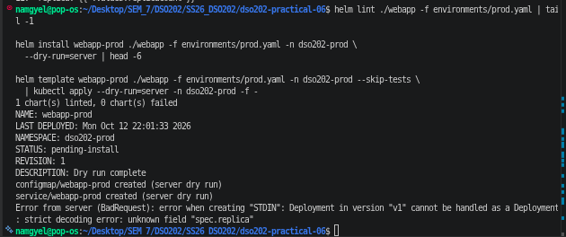

`helm lint` passed. `helm install --dry-run=server` also passed. Only `kubectl apply --dry-run=server` failed, with `strict decoding error: unknown field "spec.replica"`. Helm checks the chart and the values, but it does not check Kubernetes field names during a dry run. kubectl's server dry run sends each object to the API server with strict validation and saves nothing. I restored the file.

#### Final check for both environments

```bash
for env in dev prod; do
  helm lint ./webapp -f environments/$env.yaml &&
  helm template webapp-$env ./webapp -f environments/$env.yaml > /dev/null &&
  echo "$env: ok"
done
```

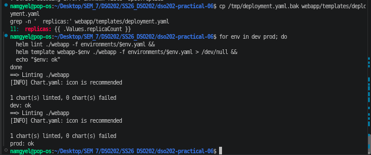

Both environments printed `ok`. The only lint note left is `[INFO] icon is recommended`, which is a suggestion and does not fail the lint.

### 4.7 Release lifecycle with my own chart

The lesson notes explain install, upgrade, rollback and server-side apply in section 3.2.3. I tested these with my own chart.

#### Installing dev

```bash
helm upgrade --install webapp-dev ./webapp -f environments/dev.yaml \
  -n dso202-dev --create-namespace --wait --timeout 3m
```

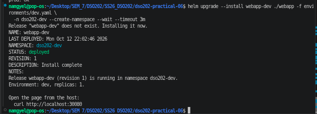

`helm upgrade --install` installs the release if it does not exist and upgrades it if it does. Running it twice gives the same result, which is why CI pipelines use it. The NOTES at the end come from my `NOTES.txt` template and tell the user to open `http://localhost:30080`.

```bash
kubectl get cm,svc,deploy,pods -n dso202-dev
curl -s http://localhost:30080
```

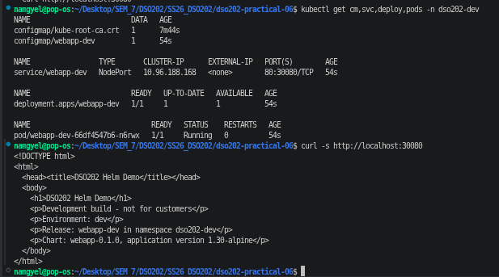


The Service is a NodePort on `80:30080/TCP`, and the page shows `Development build - not for customers` and `Environment: dev`. It opened from the host both with curl and in the browser, thanks to the port mapping in the kind config.

#### Running the chart test

```bash
helm test webapp-dev -n dso202-dev
```

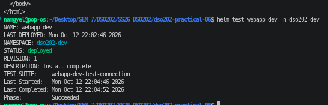

`helm test` created the busybox test Pod, which fetched the page through the Service and checked for `Environment: dev`. It finished with `Phase: Succeeded`. This shows the app actually answers, which a `deployed` status alone does not prove.

#### Installing prod

```bash
helm upgrade --install webapp-prod ./webapp -f environments/prod.yaml \
  -n dso202-prod --create-namespace --wait --timeout 3m
helm list -A
kubectl get deploy,svc -n dso202-prod
```

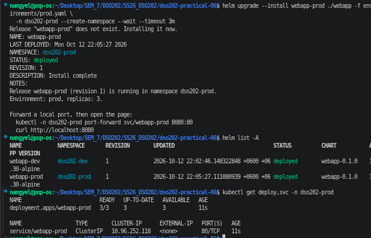

`helm list -A` now shows two releases from the same chart in two namespaces. Prod runs `3/3` replicas behind a ClusterIP Service. Only the values file was different.

#### Upgrading dev and watching the Pods roll

```bash
kubectl get deploy webapp-dev -n dso202-dev \
  -o jsonpath='{.spec.template.metadata.annotations.checksum/config}{"\n"}'
kubectl get pods -n dso202-dev
helm upgrade webapp-dev ./webapp -f environments/dev.yaml \
  --set page.message="Version 2 of the dev page" -n dso202-dev --wait
kubectl get deploy webapp-dev -n dso202-dev \
  -o jsonpath='{.spec.template.metadata.annotations.checksum/config}{"\n"}'
kubectl get pods -n dso202-dev
curl -s http://localhost:30080 | grep '<p>'
```

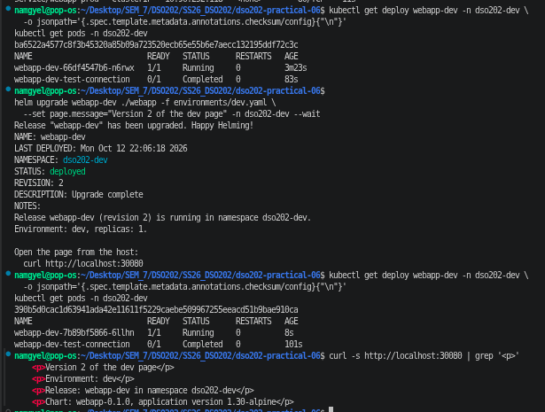

I only changed the page message, which lives in the ConfigMap. The checksum annotation changed, so the Pod template changed, and the Deployment replaced the Pod with a new one (the Pod name is different). The page now shows `Version 2 of the dev page`. Without the checksum, the ConfigMap would update but the running Pod would keep the old page. I passed `-f environments/dev.yaml` again so that no values were lost, which I learned from the podinfo failure.

#### Rolling back

```bash
helm history webapp-dev -n dso202-dev
helm rollback webapp-dev 1 -n dso202-dev --wait
helm history webapp-dev -n dso202-dev
curl -s http://localhost:30080 | grep '<p>'
```

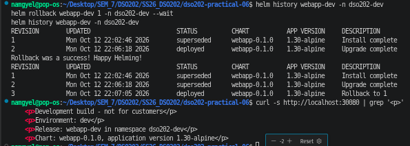

Revision 3 is `Rollback to 1`, and the page shows the original dev message again. The ConfigMap, the Deployment and the Service were all restored together. With plain kubectl, `kubectl rollout undo` only rolls back the Deployment, not the ConfigMap.

#### Failure: automatic rollback after a bad upgrade

```bash
helm upgrade webapp-dev ./webapp -f environments/dev.yaml -n dso202-dev \
  --set image.tag=does-not-exist --rollback-on-failure --timeout 90s
helm history webapp-dev -n dso202-dev
kubectl get pods -n dso202-dev
```

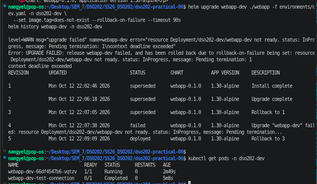

The new Pod could not pull `nginx:does-not-exist`, so it never became ready. During a rolling update the old Pod keeps running until the new one is ready, so Helm reported `Pending termination: 1` and timed out after 90 seconds. Because of `--rollback-on-failure`, Helm marked revision 4 as `failed` and created revision 5, `Rollback to 3`. It went back to revision 3 because that was the last successful one. The old Pod (`webapp-dev-66df4547b6-vqtzv`) kept serving the whole time, so the page never went down. The `webapp-dev-test-connection` Pod in `Completed` state is just left over from `helm test`.

In Helm 3 this flag was called `--atomic`. Without it, the release would have been left `failed` with a broken revision, and I would have had to roll back by hand.

#### Drift: a change made outside Helm

I changed the prod replica count with kubectl, then ran a normal upgrade with the same values file.

```bash
kubectl patch deployment webapp-prod -n dso202-prod -p '{"spec":{"replicas":5}}'
kubectl get deploy webapp-prod -n dso202-prod
helm upgrade webapp-prod ./webapp -f environments/prod.yaml -n dso202-prod
```

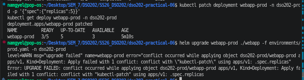

The Deployment went to 5 replicas, and the upgrade failed with a conflict on `.spec.replicas`. A change made outside Helm like this is called drift. With server-side apply, the API server records which client (field manager) owns each field. `kubectl patch` took ownership of `spec.replicas`, so when Helm tried to set it back to 3, the API server refused instead of letting the two tools overwrite each other. Helm 3 used client-side apply and would have overwritten the change silently.

```bash
helm upgrade webapp-prod ./webapp -f environments/prod.yaml -n dso202-prod --force-conflicts --wait
kubectl get deploy webapp-prod -n dso202-prod
```

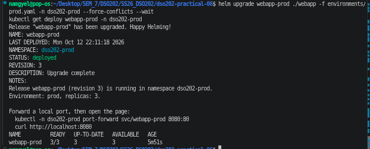

`--force-conflicts` told the API server to give ownership of the field back to Helm. The upgrade succeeded and the Deployment went back to `3/3`. The conflict is useful in practice: if an autoscaler changes replicas, the team finds out instead of Helm and the autoscaler fighting each other.

#### Final state

```bash
helm list -A | tee evidence/final-helm-list.txt
helm history webapp-dev -n dso202-dev | tee evidence/final-history-dev.txt
helm history webapp-prod -n dso202-prod | tee evidence/final-history-prod.txt
helm get manifest webapp-prod -n dso202-prod > evidence/final-manifest-prod.yaml
```

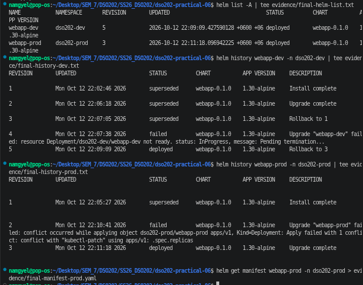

Both releases are `deployed`, and each history shows every install, upgrade, failure and rollback in order. I saved these outputs in `evidence/` before deleting the cluster.

---

## 5. What each check caught

This table is based on what I actually saw in Stage 5.

| Check | Missing required value | Wrong value type | Bad indentation | Unknown Kubernetes field | Needs a cluster |
|---|---|---|---|---|---|
| `helm lint` | Warning only, exit 0 | Yes, with schema | Yes | No | No |
| `helm template` | Yes | Yes, with schema | Yes | No | No |
| `helm install --dry-run=server` | Yes | Yes, with schema | Yes | No | Yes |
| `helm template \| kubectl apply --dry-run=server -f -` | Yes | Yes, with schema | Yes | Yes | Yes |

No single command catches everything. A safe pipeline should run `helm lint` and `helm template` for every environment file, then a kubectl server-side dry run before the real install.

---

## 6. Helm compared with Kustomize

| Point | Kustomize (Practical 5) | Helm (Practical 6) |
|---|---|---|
| How it works | Patches plain YAML with overlays | Fills templates with values |
| Source files | Valid YAML | Templates, not valid YAML until rendered |
| Record of what is installed | None | A release Secret for every revision |
| Rollback | Revert the Git commit and apply again | `helm rollback <release> <revision>` |
| Removing objects | Have to delete them yourself | `helm uninstall` removes everything it created |
| Sharing | A Git folder | A versioned chart in a repo or OCI registry |

For my own small app, Kustomize was easier to read because the files are plain YAML. Helm was more work to write, but it gave me things Kustomize does not: a version number for the whole app, release history, one-command rollback of all objects together, and clean removal. For installing software made by other people, like podinfo, Helm is clearly the better tool.

---

## 7. Problems faced and how I solved them

| Problem | Cause | Solution |
|---|---|---|
| The first podinfo install failed with `resource Deployment/dso202-helm/my-podinfo not ready ... Available: 0/2` | `kubectl get events` showed both Pods stuck at `Pulling image "ghcr.io/stefanprodan/podinfo:6.15.0"` for over 4 minutes. Each worker node was downloading the image separately on a slow connection, and Helm stopped waiting after 3 minutes | I uninstalled the failed release, pulled the image once on my laptop with `docker pull`, and loaded it into all nodes with `kind load docker-image ... --name dso202-p6`. I did the same for `nginx:1.30-alpine` and `busybox:1.37`. The reinstall finished in seconds |
| `kubectl port-forward ... 8080:9898` failed with `address already in use` | Another program on my laptop was already using port 8080 | I used local port 8081 instead (`8081:9898`). Only the local side of the mapping needs to change |
| My checksum did not match the lesson notes | The hash covers the whole rendered ConfigMap, so any tiny difference in the file changes it | Not an error. I checked that rendering twice gives the same hash |
| A failed release would block the next install with the same name | The boolean annotation install in Stage 4 left `webapp-dev` in `failed` state | I ran `helm uninstall webapp-dev -n dso202-dev` before installing the real dev release |
| The kubectl dry run in Failure 4 needs the namespace to exist | A dry run does not create namespaces | I created `dso202-prod` with `kubectl create namespace` first |

---

## 8. Answers to selected review questions

**Why does `kubectl apply -f` leave orphaned objects, and how does a release record help?**
`kubectl apply` only knows about the objects in the files you give it. If you delete an object from the file, kubectl never sees it again, so it stays in the cluster. Helm stores the full manifest of each revision, so on upgrade or uninstall it can compare and delete objects that are no longer in the chart.

**A password is put in a values file and installed. Where can it be read?**
In the values file itself (and Git, if committed), and in the release Secret in the cluster, where anyone with permission to read Secrets can see it with `helm get values`. If it was passed with `--set`, it is also in shell history and CI logs.

**Why does `helm rollback r 1` create revision 4 instead of going back to revision 1?**
Revisions are never reused or deleted by a rollback. The rollback copies revision 1 into a new revision so the history shows exactly what happened and when.

**After `helm upgrade r c --set a=1` following an install that set `b=2`, what is `b`?**
`b` goes back to the chart's default, because an upgrade with value flags starts from the defaults. `--reuse-values` or `--reset-then-reuse-values` would have kept it, and passing the same values files every time avoids the problem.

**A chart only changes its default replica count. Which version changes?**
The chart `version`, because a chart file changed. From `1.4.2` a valid new value is `1.4.3` (or `1.5.0`). `appVersion` stays the same because the application did not change.

**Why does `_helpers.tpl` never produce an object?**
Files in `templates/` whose names start with `_` are not rendered as manifests. They only hold named templates that other files call with `include`.

**What is the final value of `a` in `helm install r ./c --set a=1 -f x.yaml` if `x.yaml` sets `a: 2`?**
`a` is 1. `--set` always beats `-f` files, no matter where it appears on the command line.

**Why can `-f dev.yaml -f prod.yaml` give prod a NodePort?**
Maps are merged key by key. `prod.yaml` does not mention `service`, so dev's NodePort settings stay. I saw this in screenshot 23.

**Why does `helm lint` pass a chart that cannot render with its defaults?**
Lint reports a missing `required` value only as a warning and still exits with 0, even with `--strict`.

**Why is a misspelled field like `replica:` not caught by `helm template`?**
Templates only produce text. `helm template` checks that the result is valid YAML, but it does not check the result against the Kubernetes API schema. Only the API server does that.

**Why use `include` rather than `template` for label blocks?**
`include` returns text, so it can be piped into `nindent` to get the right indentation. `template` writes straight to the output and cannot be piped.

**JSON Schema fragment to allow only port 80 or 8080:**

```json
"port": { "type": "integer", "enum": [80, 8080] }
```

---

## 9. Conclusion

In this practical I learned Helm from both sides: as a user of someone else's chart and as the author of my own. Using podinfo showed me how releases, revisions and the release Secret work. The upgrade that silently dropped my values was the most useful lesson, because it reported success while changing the app in a way I did not ask for. Since then I always pass every values file on every upgrade.

Writing the `webapp` chart taught me that most template problems come from indentation and data types rather than logic. YAML turning `1.30` into `1.3`, `--set` turning `true` into a boolean, and a missing `nindent` all looked fine until I checked carefully. The values schema fixed the type problems, and the four failures in Stage 5 showed me that no single check is enough. A pipeline needs `helm lint`, `helm template` for every environment, and a server-side dry run.

The lifecycle tests showed what Helm adds over plain kubectl and Kustomize. I could roll back the ConfigMap and Deployment together, a bad image was rolled back automatically without downtime, and server-side apply refused to silently overwrite a change made with kubectl. The chart I wrote here is the starting point for the final project item "Create Helm charts for deploying the application to Kubernetes", where I will extend it to the frontend, backend and PostgreSQL parts of the task tracker app.

---

## 10. Cleanup

```bash
helm uninstall webapp-dev -n dso202-dev
helm uninstall webapp-prod -n dso202-prod
kubectl delete namespace dso202-dev dso202-prod dso202-helm
kind delete cluster --name dso202-p6
```

The cluster can be rebuilt from `cluster/kind-cluster.yaml`, and both releases can be reinstalled from the `webapp/` chart and the `environments/` files in this folder.